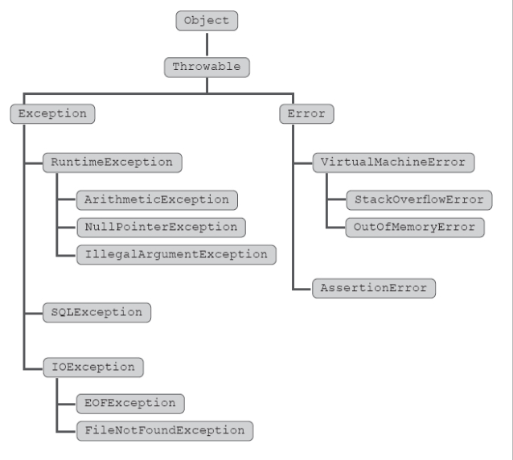
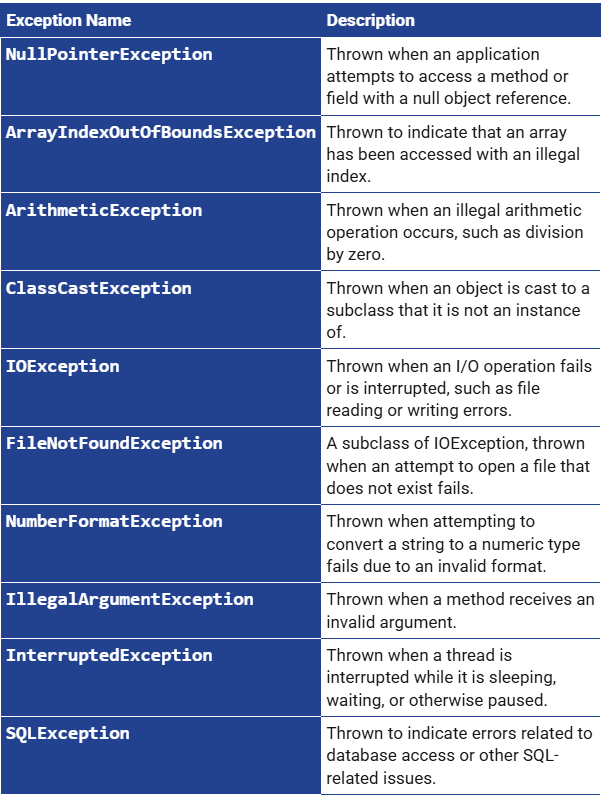

# The Exception Hierarchy in Java

Each branch shows which classes inherit from a common parent. For example, `ArithmeticException` extends `RuntimeException`, so a `catch (RuntimeException e)` block can catch an `ArithmeticException`.

`IOException` is a checked exception. When a method you call declares `throws IOException`, you must catch it or declare it in your own method with `throws`. Java does not require either for `RuntimeException` or its subclasses.

## Common Java Exceptions

