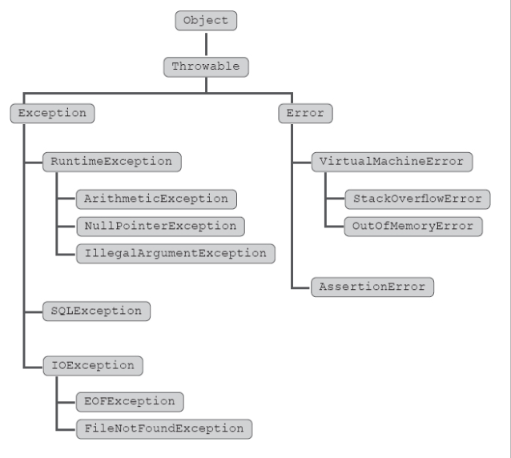

# La jerarquía de excepciones en Java

Cada rama muestra qué clases heredan de una clase común. Por ejemplo, `ArithmeticException` hereda de `RuntimeException`, así que un bloque `catch (RuntimeException e)` puede capturar una `ArithmeticException`.

`IOException` es una excepción comprobada (*checked*). Si llamas a un método que declara `throws IOException`, debes capturarla o declarar que tu propio método puede propagarla con `throws`. Java no exige ninguna de las dos cosas para `RuntimeException` y sus subclases.

## Excepciones comunes en Java

| Nombre de la excepción | Cuándo ocurre |
| --- | --- |
| `NullPointerException` | Se intenta acceder a un campo de instancia o llamar a un método de instancia mediante una referencia nula. |
| `ArrayIndexOutOfBoundsException` | Se intenta acceder a un arreglo con un índice negativo o mayor o igual a su longitud. |
| `ArithmeticException` | Se intenta realizar una operación aritmética inválida, como una división entera por cero. |
| `ClassCastException` | Se intenta convertir un objeto a un tipo del que no es una instancia. |
| `IOException` | Falla una operación de entrada o salida, como leer o escribir un archivo. |
| `FileNotFoundException` | No se puede abrir un archivo, por ejemplo, porque no existe. Es una subclase de `IOException`. |
| `NumberFormatException` | Se intenta convertir una cadena a un tipo numérico y su formato no es válido para ese tipo. |
| `IllegalArgumentException` | Un método recibe un argumento inválido. |
| `InterruptedException` | Se interrumpe un hilo mientras duerme, espera o realiza otra operación interrumpible. |
| `SQLException` | Se produce un error de acceso a una base de datos u otro error relacionado con SQL. |
